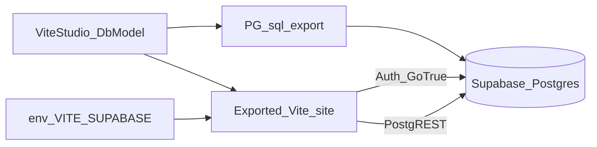

# Supabase deploy (Form↔DB Phase C)

**Product:** Lumen · **Status:** Phase C — export adapters shipped; Preview stays on the local stub.

## Why Supabase first

- PG `.sql` export already targets PostgreSQL 17 + `enable row level security` on every table.
- One vendor for Auth + Postgres + (optional) Storage later.
- Clerk (or other IdPs) can still plug in later via `AuthAdapter` without changing page nodes — not shipped in Phase C.

## Path



1. Design tables in **ฐานข้อมูล**.
2. **ส่งออก .sql** → paste into Supabase SQL Editor (or `supabase db push` if you use the CLI).
3. Export / open the site folder; copy `.env.example` → `.env`.
4. Set:
   - `VITE_WB_DB_BACKEND=supabase`
   - `VITE_SUPABASE_URL=https://….supabase.co`
   - `VITE_SUPABASE_ANON_KEY=…` (anon/public key only)
5. `bun install && bun run dev` (or build).

## Auth vs app tables

| Concern | Stub (default) | Supabase |
|---|---|---|
| Session | `sessionStorage` | GoTrue access token in `localStorage` |
| Login form (`dbForm` op `load`) | Hash compare in stub users | `POST /auth/v1/token?grant_type=password` |
| Signup (auth-like table insert) | Hash + local users | `POST /auth/v1/signup` then optional profile insert |
| CRUD list/edit | `localStorage` | PostgREST `/rest/v1/{table}` |

Use **email** as the identity column for login/signup against Supabase Auth.  
Do not store plaintext or client-stub password hashes in Postgres when Auth is on.

## RLS

The SQL export ends with `alter table … enable row level security` and **no policies**. Until you add policies, anon/authenticated cannot read or write. Example (adjust to your app):

```sql
-- After auth.users exists (Supabase default):
create policy "read own profile"
  on public.users for select
  using (auth.uid()::text = id::text);
```

Wire `users.id` to `auth.users.id` (uuid) when you harden the profile table.

## Files in the export

- [`export-templates/vite-react/src/lib/wb-db-runtime.ts`](../export-templates/vite-react/src/lib/wb-db-runtime.ts) — picks stub vs Supabase Auth
- [`export-templates/vite-react/src/lib/wb-db-supabase.ts`](../export-templates/vite-react/src/lib/wb-db-supabase.ts) — GoTrue + PostgREST (fetch, no SDK)
- [`export-templates/vite-react/src/lib/wb-db-client.ts`](../export-templates/vite-react/src/lib/wb-db-client.ts) / `wb-db-submit.ts` — route by env
- [`.env.example`](../export-templates/vite-react/.env.example)

## Preview in the desktop app

Unchanged: Preview uses the test SQLite + stub AuthAdapter inside Tauri. Point a built export at Supabase to verify production.

## Later (not Phase C)

- Clerk / custom JWT `AuthAdapter`
- OAuth providers, email verify UI
- Generated RLS policy packs from `DbModel`
- Live Preview → remote Supabase from the desktop app
